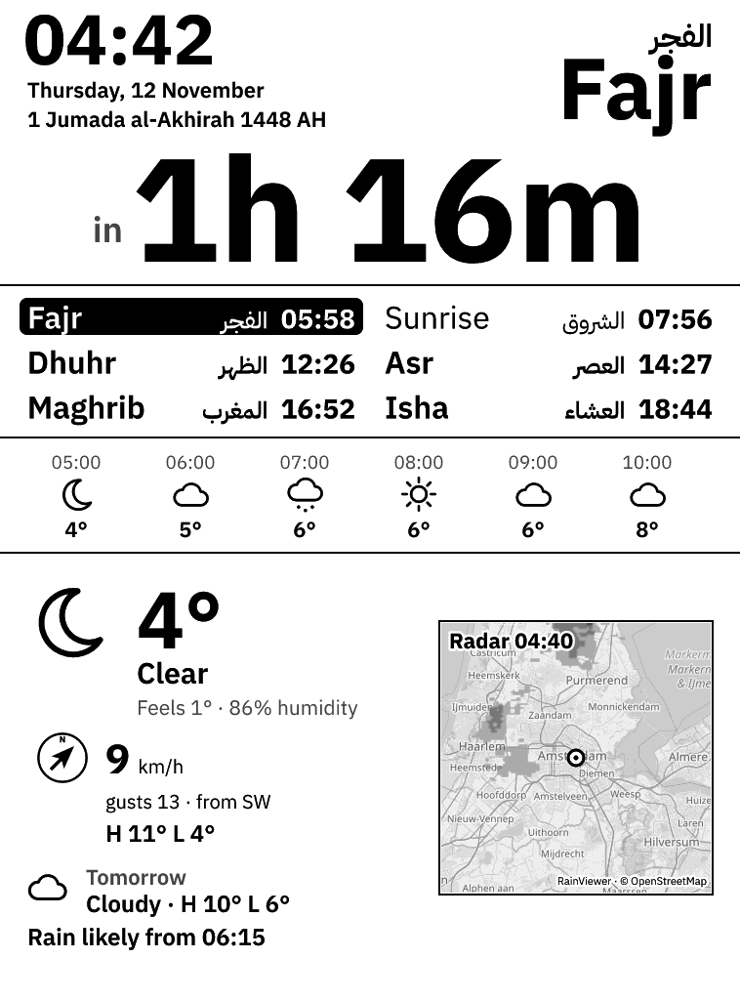

# miqat

A wall-mounted prayer-times and weather dashboard for an old Kindle Paperwhite.



It shows:
- the time left until the next prayer, as the biggest thing on the screen
- the clock, Gregorian and Hijri dates, and the next prayer's name
- the six daily times in two columns, the upcoming one highlighted
- current weather, wind speed, gusts and direction, today's high and low
- the next six hours
- tomorrow's weather
- a 2-hour rain outlook
- a live rain radar map, shown only when rain is expected; otherwise the
  conditions and tomorrow take that space

## How it works

The rendering engine is also available as a Rust library (`miqat::layout`,
`miqat::prayer`, `miqat::render`, and `miqat::sources`). Kindil can therefore
reuse the exact dashboard without copying its layout or changing the server CLI.

```
home server (miqat serve)                         Kindle (KUAL extension)
  Open-Meteo  ─┐                                    every minute:
  RainViewer  ─┼─► render 758×1024 gray PNG ◄──────  curl http://server:8080/dash.png
  OSM tiles   ─┘   prayer times computed locally     eips -g dash.png
```

The server does all the work. The Kindle only downloads an image and draws it. This avoids two PW1 limits:
- Its browser is too old to run a dashboard page.
- Its `curl`/OpenSSL can't do modern HTTPS. Plain HTTP on your LAN works fine.

Refresh rates:
- Weather: every 15 minutes.
- Radar: every 10 minutes.
- Map: fetched once at startup.
- Frame: re-rendered on each request, so the clock and countdown are current to the minute.

## Server

```bash
cp config.example.toml config.toml   # set your location, method, units
cargo run -- render --out dash.png   # one frame, to check the layout
cargo run -- serve                   # http://localhost:8080/ previews it in a browser
```

Run it on the home server with any of these:
- **Binary + systemd**: `cargo install --git https://github.com/sharno/miqat`, then see [`deploy/miqat.service`](deploy/miqat.service).
- **Docker**: `docker build -t miqat .`, then `docker run -d --restart=unless-stopped -p 8080:8080 -v /path/to/config.toml:/config/config.toml:ro miqat`.

Endpoints:
- `/dash.png`: the frame.
- `/`: a browser preview.
- `/healthz`: health check.

Keep port 8080 on the LAN. Don't forward it.

### Privacy

- `config.toml` is git-ignored. Your coordinates only live on your server.
- City-level coordinates (2 decimals, ~1 km) are enough.
- Prayer times are computed locally.
- Open-Meteo receives coordinates rounded to 2 decimals.
- RainViewer and OpenStreetMap only see map tile indexes (~200 km tiles).

## Kindle

### 1. Jailbreak

The PW1's last firmware is 5.6.1.1. Check yours in Settings → Device Info. Follow the current guide at [kindlemodding.org](https://kindlemodding.org/).

On 5.6.1.1, MobileRead users report that WinterBreak often fails on the PW1. The route that works for them:
1. Downgrade to 5.3.3 or 5.4.4.
2. Run the classic K5 jailbreak.
3. Install MRPI and KUAL.

Firmware changes can brick a device. Read the current MobileRead threads before you start.

### 2. Install the extension

1. Connect the Kindle over USB.
2. Copy `kindle/extensions/miqat` to the Kindle's `extensions/` folder.
3. In `extensions/miqat/miqat.conf`, set `SERVER_URL` to your server, e.g. `http://192.168.1.50:8080/dash.png`. Give the server a fixed DHCP lease.
4. Eject. In KUAL → Miqat, run **Show one frame (test)** to check the connection.
5. Run **Start dashboard**.

Start stops the Kindle UI, keeps the screen awake, and redraws every minute. Every 30th frame does a full flash to clear ghosting. If the server is unreachable, the last frame stays up marked `OFFLINE`, and Wi-Fi is cycled every third failure.

To get the normal Kindle back, either:
- hold the power button ~15 s to reboot, or
- run `extensions/miqat/bin/stop.sh` over SSH (USBNetwork).

The log is at `extensions/miqat/miqat.log`.

### 3. Mount

Keep it on USB power. Updates once a minute with Wi-Fi on will drain the battery in a few days. Set `FRONTLIGHT` in `miqat.conf` if you want it lit at night.

## Configuration

See [`config.example.toml`](config.example.toml):

| Key | Values |
| --- | --- |
| `prayer.method` | `muslim_world_league`, `egyptian`, `karachi`, `umm_al_qura`, `dubai`, `moonsighting_committee`, `north_america`, `kuwait`, `qatar`, `singapore`, `tehran`, `turkey` |
| `prayer.madhab` | `shafi`, `hanafi` |
| `prayer.adjust_minutes` | per-prayer offsets, to match a mosque timetable |
| `prayer.hijri_offset_days` | shift the tabular Hijri date to match local sighting |
| `weather.temperature_unit` / `wind_unit` | `celsius`/`fahrenheit`; `kmh`/`ms`/`mph`/`kn` |
| `radar.zoom` | 3–9, default 8 (~150 km across). Radar past 7 is RainViewer's zoom-7 data upscaled, since its free tiles stop there |
| `display.clock` | `12h`, `24h` |
| `display.contrast` | 1.0–3.0, default 1.5. The e-ink panel has 16 gray levels and lifts the middle of the range, so the frame is darkened with this gamma to compensate. Raise it if the text still looks washed out |

## Data and credits

- Weather: [Open-Meteo](https://open-meteo.com/) (CC BY 4.0)
- Radar: [RainViewer](https://www.rainviewer.com/api.html), free for personal use with attribution
- Map: © [OpenStreetMap](https://www.openstreetmap.org/copyright) contributors. Tiles are fetched once per server start, per the [tile usage policy](https://operations.osmfoundation.org/policies/tiles/)
- Prayer times: [`salah`](https://github.com/insha/salah), a Rust port of Adhan
- Font: IBM Plex Sans Arabic (SIL OFL 1.1, [`assets/fonts/OFL.txt`](assets/fonts/OFL.txt))
